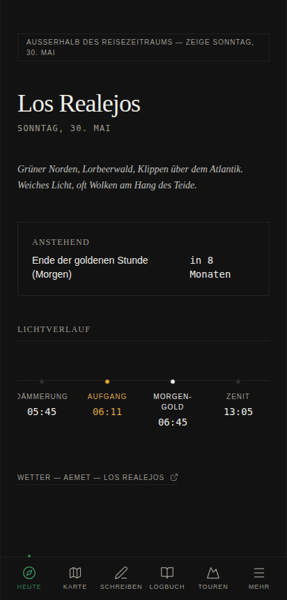
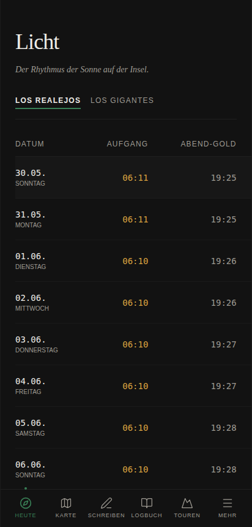
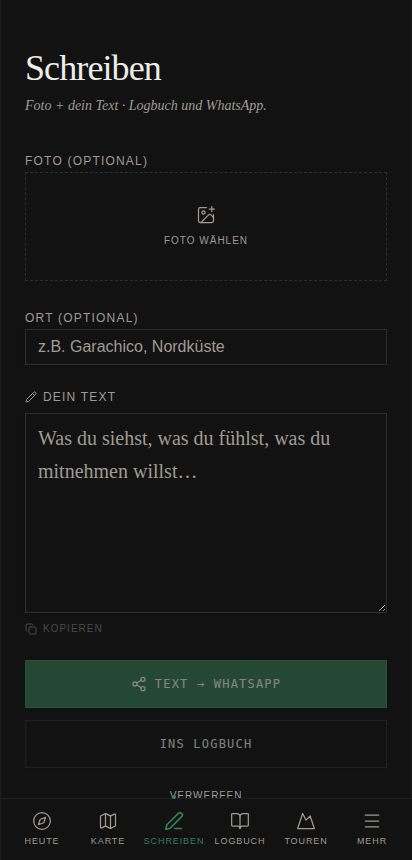
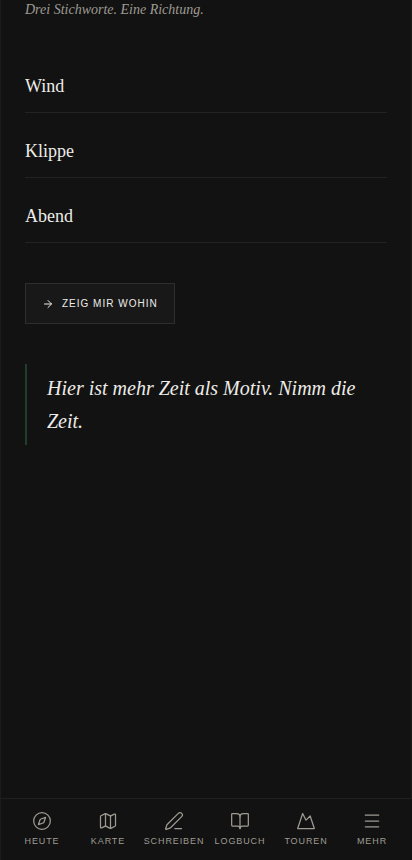

# Teneriffa-App

**A personal travel companion for two weeks on Tenerife, developed through a human-led, AI-assisted workflow.**

> **Status: finished, then opened up.** The app was used on a real trip. This public
> version runs without any server or AI service and uses a fictional sample trip, so anyone can open it:
> **[uta-kaehler.github.io/teneriffa-app](https://uta-kaehler.github.io/teneriffa-app/)** (best on a phone).

A web app that behaves like an installed phone app: a map with about 60 places across the island, the light of
the day for photography, a writing page that sends a photo with one's own words straight to a messenger, and a
logbook that keeps it all. Week one on the green north coast, week two below the cliffs of Los Gigantes.

The interface is in German. It was built for one trip, not as a product.

<p>
  
  
  
  
</p>

*Screenshots of the public version with the sample trip.*

## What it does

| Area | What you see |
| --- | --- |
| Heute (Today) | Where you are, the light of the day (dawn, sunrise, golden and blue hour), what comes next, a short morning suggestion matched to the weather |
| Karte (Map) | About 60 places: guachinches, markets, viewpoints, beaches, villages. Each with a short text, best light, effort, opening hours, cautions and camera notes. Places turn gold once visited |
| Schreiben (Write) | Choose a photo, write your own words, share both to a messenger in full resolution or keep them in the logbook |
| Logbuch | All entries with photos, exportable as a file |
| Touren | Day trips: Anaga, Masca, Punta de Teno, a night at the Teide, whale watching |
| Mehr (More) | Light over the day, day planner, guachinches, slideshow, and *Richtung*: three keywords, one invitation where to look |

## How it was developed

This app was built by one person who writes no code, over many evenings, in conversation with several AI systems.

It started with a short video about "vibe coding". Uta Kähler asked Gemini what that was, and Gemini answered:
describing apps or websites in plain language and having them built. Asked what one could build, Gemini suggested a
travel guide for her upcoming trip to Tenerife and pointed her to Replit. Claude (on claude.ai) was sceptical
at first: with this way of working you put something in, get something out, and cannot follow the path in between.
Her answer was that language is something she can do. So they tried.

After a first start the project rested for a while and picked up again when the trip came closer. From then on it was
built on many evenings by four parties: Uta with Gemini and Claude, who wrote the prompts, and the Replit Agent, which
built the app. Working out what she actually wanted, and how it should look, took most of the time.

One observation changed the way of working. Gemini's prompts for the build agent regularly closed with polite phrases
such as thanks. Asked about it, Gemini explained that the agent was itself a language-model-based system. Until then
Uta had understood the agent as a building tool only. From then on she no longer just relayed prompts but addressed
the agent directly as a conversational partner in the build.

On the trip, five small features asked Claude through an interface: a one-sentence *wind impulse* at start-up, a
*direction* from three keywords, a *comment on the light*, a plant identification and a writing assistant. The writing
assistant was taken out during the project: a one-off generated caption, without any follow-up exchange, did not fit
her conversational way of working, and she preferred to write her captions herself. That decision carries over into
this version.

| Participant | Contribution |
| --- | --- |
| **Uta Kähler** (final responsibility) | Idea, requirements, design direction, choice of places, tests on the road, decisions on what the public version may show |
| **Gemini** (Google) | The first idea, the suggestion to use Replit, prompts for the build |
| **Claude** (Anthropic, claude.ai) | Thinking along, developing the requirements, prompts for the build, texts inside the app |
| **Replit Agent** | Built the original app |
| **Claude Code** (Anthropic) | Converted it into this public version |

This describes an observable way of working, not claims about the inner states of the systems involved.

## What changed for the public version

| Before | Now |
| --- | --- |
| A small server delivered places, light data and restaurant lists | Everything is calculated in the browser; the app is a static website |
| Five features called Claude through an interface | Handwritten sentences in the same tone: a deck of invitations for *Richtung*, a set of wind impulses, a light comment built from the light data. The plant identification and the writing assistant were removed |
| Texts tied to the dates of the real trip (first, middle and last day) | Short notes about six places, shown when you arrive there |
| Real accommodations with names and addresses | Town centres of Los Realejos and Los Gigantes |
| Real travel dates | A fictional trip, 30 May to 13 June 2027 |
| Personal photos and documents in the project | Not part of this repository |

Weather comes from Open-Meteo, map tiles from OpenStreetMap. Nothing else leaves the phone; logbook entries and
photos stay in the browser's storage.

## Running it

```
npm install
npm run dev
```

`npm run build` creates the static site in `dist/`; the published copy lives in `docs/`. By default it is built for the path `/teneriffa-app/`;
set `BASE_PATH=/` to build for the root of a domain.

Built with React, Vite, Tailwind, Leaflet and SunCalc.

## Related

- [Honig-App](https://github.com/uta-kaehler/honig-app): the successor, for a road trip through Morocco
- [Fotoaufräumer](https://github.com/uta-kaehler/fotoaufraeumer): sorting holiday photos
